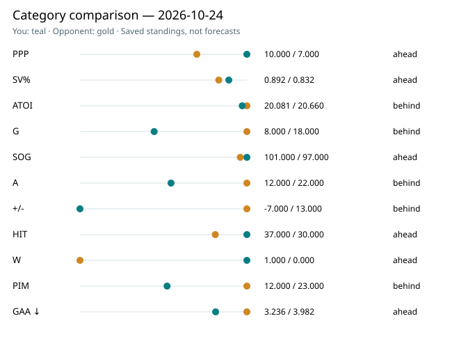

# PuckSignal

Finding the signal in hockey performance.

A hockey analytics research project using R and Python to explore player talent,
repeatability, predictive value, NHL performance, and NCAA-to-NHL translation.

## Research Goals

- Explore NHL player performance through descriptive statistics
- Identify which player metrics represent repeatable skills
- Determine which metrics have predictive value
- Explore player archetypes and similarities
- Study NCAA-to-NHL player translation
- Develop better measures of player contribution beyond traditional box scores

## Local setup

[Second-machine setup and daily forecast command](docs/LOCAL_SETUP.md).

## Today’s NHL game predictions

[Tuesday, October 20 NHL matchups](https://erinyep.github.io/Rink-Lab-2027/games/) —
projected goals, shots, scoring leans and goalie scenarios for all 22 teams.
[Reading guide](docs/games/README.md).

## Today’s fantasy report

[Quinn’s local report and roster alerts](reports/today/README.md).

[Interactive browser report](https://erinyep.github.io/Rink-Lab-2027/report/)
(requires the [one-time Pages setup](docs/GITHUB_PAGES.md)).

## Current forecast work

October 20: [Season-to-date model review](outputs/per_game_forecast/season_through_2026-10-19/README.md)
covers 140 final games with explicit saved-forecast gaps. New official PBP,
MoneyPuck shot-quality and public Kalshi source audits support the
[data-source strategy](docs/DATA_SOURCE_STRATEGY.md). A complete
[October 20 pregame slate](outputs/per_game_forecast/2026-10-20_20261020T125723Z_pregame_readout.md)
was issued through the new validated skater/goalie runner. No D-context
coefficient or market blend is promoted.

October 16: [Weekly model performance, player/team inputs and visuals](outputs/per_game_forecast/week_2026-10-12/README.md).
Review covers 32 final October 12–15 games with explicit forecast coverage,
all-category metrics, player/team SOG contribution tables and defense opportunity
proxies. A single command now acquires actuals, re-evaluates issued models and
publishes the review. See [next steps](NEXT_STEPS.md) for pregame automation and
prospective feature-validation priorities.

October 14: [October 13 results and model recommendations](outputs/per_game_forecast/2026-10-13_results_readout.md).
All 16 games checked against October 9-issued default forecasts; 558/575 skater
appearances covered. No October 13 challenger/goalie slate was issued. The
readout separates this evaluation from the pooled October 10/12 five-model
comparison and prioritizes daily issuance, roster coverage and role/usage tests.

October 13: [October 12 night results](outputs/per_game_forecast/2026-10-12_results_readout.md).
Candidate led the two-game shot comparison; default still edges it over the
combined fantasy-rostered sample. Frozen sources and evaluated reading views
are linked in the report, including separately issued goalie forecasts.

October 12: [latest model results and adjustments](outputs/per_game_forecast/recent_results_2026-10-12.md).
The 11-game prospective comparison favors candidate overall, while default
performs better on fantasy-rostered players. All recent completed games and
forecast timing limitations are documented.

October 10: [today's projections and reading guide](outputs/per_game_forecast/README.md).
Five skater models and two goalie scenarios cover all 14 games, with 11 issued
before puck drop and three explicitly labeled late. Stats are cut off before
October 10; availability is timestamped at retrieval.

For October 9, start with the [consolidated results guide](data/processed/forecasts/october_9_review/README.md)
or [forecast status](outputs/per_game_forecast/README.md). The derived reading
folder groups players, team totals and goalies while preserving frozen source runs.

The conditional per-game skater baseline, frozen game comparisons, and seeded
integer simulations are implemented. The live default remains recency-weighted
history; the pooled shot/assist calibration remains experimental. All 65 completed
current-season games through October 8 are archived and reconciled with season
reports. See the
[forecast guide](docs/PER_GAME_FORECAST.md),
[current status and readouts](outputs/per_game_forecast/README.md), and
[next tasks](NEXT_STEPS.md). Separate provisional goalie rates/start shares and
an opponent-shot-volume trial now exist; confirmed starters, chronological goalie
validation, participation and fantasy lineup optimization remain later milestones.
Simulation ranges are provisional, not
calibrated predictive intervals; the October 9 readout records every covered game.
