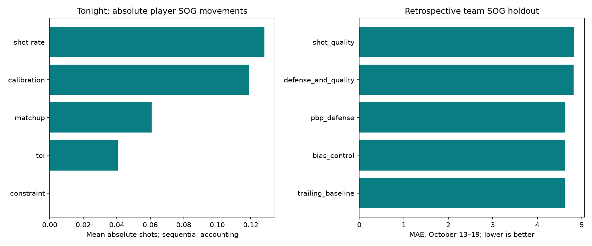

# Feature evidence before October 20 games

Created 2026-10-20T19:46:21.854910+00:00. Existing forecast bundle: daily_2026-10-20_20261020T125723Z. Main forecasts are preserved; new team trials are issued separately before puck drop.

## Decision for tonight

The new features do not beat the bias control in this declared screen: control MAE 4.621, D measures 4.634, shot quality 4.823. All feature-gain intervals cross zero. Retain the current main models; test the new variants prospectively. This does not establish that the sources are useless or that other feature definitions cannot help.

In the 13-game saved player cohort, calibration is the clearest overall improvement among these ordered steps (MAE change -0.018 SOG); its fantasy-subgroup change is +0.022, so the overall benefit cannot be assumed for roster decisions. Recent shot-rate and matchup adjustments do not show a reliable overall gain. These results apply to SOG; goals, assists, fantasy categories and goalies need separate tests.

## What drives tonight's player forecasts?

[Per-player accounting](player_contributions.csv) and [per-team accounting](team_contributions.csv) reconcile the existing usage trial exactly. The order is default baseline → TOI → shot rate → calibration → matchup → count constraints. Values are changes in expected SOG relative to the existing baseline, not shares of the entire prediction. A component that moves a prediction most is not necessarily the component that improves accuracy. These interacting contributions depend on order; they are neither causal importance nor independent feature value. Defense PBP and new MoneyPuck shot-quality effects in the main forecasts remain zero. Team replacements are shown separately. Candidate changes shots by a common multiplier; it does not establish player-specific variable importance.

## Do those existing components help?

October 10/12 saved pregame contexts matched to positive-TOI actual appearances; the same rows are used for each stage. Negative MAE delta helps. Calibration was originally fitted on earlier October data, not on these rows. Intervals resample whole games (equal game weight); per-player MAE delta can differ from equal-game delta. These are retrospective component reconstructions from saved inputs, not separately issued ablation forecasts. Population is conditional on appearing and does not validate participation probabilities.

| component | scope | player_rows | games | mean_absolute_movement | mae_delta | game_weighted_delta | ci_low | ci_high |
| --- | --- | --- | --- | --- | --- | --- | --- | --- |
| toi_contribution | all | 468 | 13 | 0.036 | -0.004 | -0.004 | -0.008 | 0.001 |
| shot_rate_contribution | all | 468 | 13 | 0.111 | 0.002 | 0.002 | -0.012 | 0.015 |
| calibration_contribution | all | 468 | 13 | 0.12 | -0.018 | -0.018 | -0.03 | -0.005 |
| matchup_contribution | all | 468 | 13 | 0.068 | 0.006 | 0.006 | -0.001 | 0.014 |
| constraint_contribution | all | 468 | 13 | 0.0 | -0.0 | -0.0 | -0.0 | 0.0 |

[Position and fantasy subgroups](component_performance.csv). Effects are ordered; change order and attribution can change. This small cohort cannot establish stable per-player predictive importance.

## Do the new data add team predictive value?

Train 2026-10-05–2026-10-12 (50 games, 100 team rows); hold out 2026-10-13–2026-10-19 (51 games, 102 team rows). Design fixed in configuration before this run: 20-game baseline shrinkage, ridge penalty 20, training-only standardization and missing-value imputation. The baseline averages own historical SOG and opponent historical SA, shrunk toward the past-only league average. All target-date events are excluded. The bias control fits only an intercept; feature models must beat it, not merely fix a baseline bias. No tuning/selection on this holdout.

| model | team_rows | games | mae | bias |
| --- | --- | --- | --- | --- |
| bias_control | 102 | 51 | 4.621 | -0.931 |
| defense_and_quality | 102 | 51 | 4.813 | -1.024 |
| pbp_defense | 102 | 51 | 4.634 | -0.954 |
| shot_quality | 102 | 51 | 4.823 | -1.013 |
| trailing_baseline | 102 | 51 | 4.62 | -0.642 |

Paired game-bootstrap MAE deltas against bias control (negative helps; 95% exploratory intervals):

| model | comparison | games | mae_delta | ci_low | ci_high |
| --- | --- | --- | --- | --- | --- |
| defense_and_quality | bias_control | 51 | 0.192 | -0.118 | 0.515 |
| pbp_defense | bias_control | 51 | 0.013 | -0.294 | 0.281 |
| shot_quality | bias_control | 51 | 0.202 | -0.098 | 0.496 |
| trailing_baseline | bias_control | 51 | -0.001 | -0.052 | 0.045 |

D features: own D attempt share, own followup attempts per game, opponent D attempt share. Shot-quality features: own D xG, D expected rebounds and team xG per game. PBP/shot quality use quarantines from the source audits; all teams remain, missing values receive training means (zero standardized effect). [Feature rows and source sample sizes](historical_team_features.csv) retain coverage.

This is a retrospective corrected-data screen, not a prospective season backtest: October 20 downloads may contain later revisions, and model/source quarantine choices were made after results were available. There is no archived as-of history for the new inputs. The test is small, early-season and does not validate individual players, goals or goalies. No model promotion or winning-edge claim follows from this test alone.

## Tonight's frozen experiment

[Experimental team SOG forecasts](tonight_experimental_team_forecasts.csv) refit every declared variant on data through October 19. These are separate team-volume research forecasts, not adjustments to individual player forecasts or replacements for the published five models. All four variants are preserved, including controls; no holdout winner is silently selected. Main lineup-based team projections and this trailing-team baseline have different populations/assumptions. [Parameters](fitted_models.json) expose standardized coefficients and centering; coefficients are conditional on correlated inputs.

Tomorrow: score these frozen forecasts against official actuals on the same games, inspect coverage/position/fantasy stability, and accumulate unseen games before promotion. Use `scripts/evaluate_feature_evidence.py --evidence <this-directory> --actuals <refreshed-official-actuals> --out <new-evaluation-directory>` to score all frozen variants on identical completed games without refitting. Archive new PBP/shot-quality snapshots daily for actual as-of testing. Acquire shifts next for defensible D-pair and PP exposure. No passing/possession or causal creation claim is supported by standard PBP alone.
