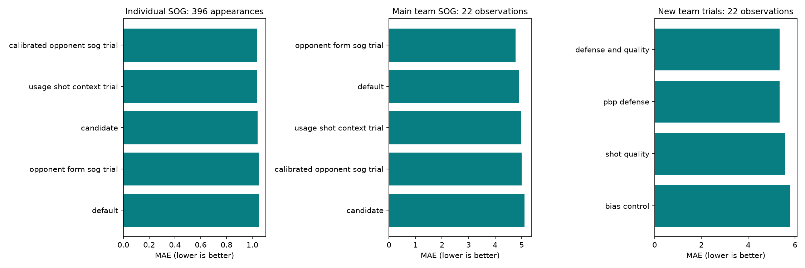

# October 20 model results — first prospective feature test

All 11 games final; 396 positive-TOI skater appearances, 83 saved fantasy-roster appearances and 22 actual goalie starts. Main and experimental forecasts were frozen before puck drop. Evaluation uses the same official actuals, identical available observations per model, unchanged coefficients and no outcome-based selection. All 667 source checks verify; no provenance exceptions.

## What the new protocol found

The new defense trial improves its own control (team SOG MAE 5.792→5.344, about 7.7%); defense plus quality reaches 5.342. All paired 95% feature intervals still include zero. This first unseen slate reverses the earlier retrospective screen, rather than confirming a stable effect. The main opponent-shots model is better on this slate (4.775), so the new trials are not an upgrade over our existing team forecasts. The baselines differ; incremental feature gains are measured against the frozen research control, not assigned to the main player-based models.

Calibrated opponent context leads all-player SOG (1.037 vs default 1.051); the game-bootstrap difference is -0.014, 95% interval [-0.025,-0.005]. It improves 9/11 games. This small effect does not transfer to fantasy players: opponent-only leads that subset (1.388 vs default 1.395), while candidate and calibrated candidate are worse than default. Fantasy difference intervals all include zero. Multiple correlated comparisons and one slate are exploratory; no automatic promotion.

Goalie opponent context improves saves MAE 6.440→6.152 and GA MAE 0.913→0.890, but paired intervals include zero. Full-start forecasts are scored against actual starters with variable durations; 55–65-minute and relief populations remain separate in the download. Saves p10–p90 coverage is only 59.1% for both variants, showing the provisional intervals need work.

## Main individual and fantasy SOG

| model | rows_scored | mae | bias | interval_p10_p90_coverage |
| --- | --- | --- | --- | --- |
| calibrated_opponent_sog_trial | 396 | 1.037 | -0.097 | 0.899 |
| candidate | 396 | 1.04 | -0.103 | 0.904 |
| default | 396 | 1.051 | 0.017 | 0.904 |
| opponent_form_sog_trial | 396 | 1.048 | 0.024 | 0.904 |
| usage_shot_context_trial | 396 | 1.038 | -0.118 | 0.902 |

Saved fantasy roster subset (ownership is frozen at issuance, not today's roster):

| model | rows_scored | mae | bias | interval_p10_p90_coverage |
| --- | --- | --- | --- | --- |
| calibrated_opponent_sog_trial | 83 | 1.401 | -0.461 | 0.855 |
| candidate | 83 | 1.408 | -0.475 | 0.855 |
| default | 83 | 1.395 | -0.287 | 0.855 |
| opponent_form_sog_trial | 83 | 1.388 | -0.272 | 0.855 |
| usage_shot_context_trial | 83 | 1.413 | -0.457 | 0.843 |

[All nine player categories](player_metrics.csv) · [Paired player/fantasy differences](player_paired_uncertainty.csv) · [Results by fantasy team](fantasy_team_metrics.csv) · [Player outcomes](player_results.csv).

## Main team SOG

| model | rows_scored | mae | bias | interval_p10_p90_coverage |
| --- | --- | --- | --- | --- |
| calibrated_opponent_sog_trial | 22 | 5.002 | -1.707 | 0.773 |
| candidate | 22 | 5.11 | -1.817 | 0.727 |
| default | 22 | 4.898 | 0.345 | 0.727 |
| opponent_form_sog_trial | 22 | 4.775 | 0.464 | 0.773 |
| usage_shot_context_trial | 22 | 4.991 | -2.034 | 0.727 |

[All six team categories](team_metrics.csv) · [Team paired differences](team_paired_uncertainty.csv) · [Each team's outcome](team_results.csv).

## New feature experiment — prospective October 20 only

| model | team_rows | games | mae | bias |
| --- | --- | --- | --- | --- |
| bias_control | 22 | 11 | 5.792 | -1.432 |
| defense_and_quality | 22 | 11 | 5.342 | -1.436 |
| pbp_defense | 22 | 11 | 5.344 | -1.476 |
| shot_quality | 22 | 11 | 5.574 | -1.379 |

Negative paired MAE delta versus the research bias control helps:

| model | comparison | games | mae_delta | ci_low | ci_high |
| --- | --- | --- | --- | --- | --- |
| defense_and_quality | bias_control | 11 | -0.45 | -1.059 | 0.093 |
| pbp_defense | bias_control | 11 | -0.449 | -0.949 | 0.056 |
| shot_quality | bias_control | 11 | -0.219 | -0.733 | 0.193 |

All 22 experimental team actuals equal official NHL team SOG. No refitting took place in evaluation. The historical corrected-data screen and this genuinely future slate are kept separate; do not pool them as equivalent prospective observations. Source-vintage limitations from the original screen still apply to training, while tonight's frozen inputs and predictions are available for inspection.

[Scored experimental predictions](feature_trials/scored_predictions.csv) · [Frozen October 20 evidence](../evidence/README.md).

## Which existing components helped?

These are exact sequential reconstructions from saved pregame inputs: baseline → TOI → rate → calibration → matchup → count constraints. They are diagnostic accounting, not separately issued ablation models, causal importance, or stable player-specific importance. Negative error delta helps; intervals resample whole games with appearance weights. Order and interactions matter.

| component | scope | rows | games | mean_absolute_movement | mae_delta | lower_95 | upper_95 |
| --- | --- | --- | --- | --- | --- | --- | --- |
| toi_contribution | all | 396 | 11 | 0.04 | -0.005 | -0.009 | -0.001 |
| shot_rate_contribution | all | 396 | 11 | 0.128 | 0.012 | -0.0 | 0.024 |
| calibration_contribution | all | 396 | 11 | 0.119 | -0.011 | -0.019 | -0.003 |
| matchup_contribution | all | 396 | 11 | 0.061 | -0.01 | -0.021 | -0.001 |
| constraint_contribution | all | 396 | 11 | 0.0 | 0.0 | -0.0 | 0.0 |

[Position and fantasy component results](component_performance.csv) · [Per-player contribution/outcome audit](player_component_results.csv). The rate update hurt aggregate SOG accuracy at this stage; calibration and matchup recovered some error. One game's outcome cannot establish whether an individual player's variable is predictive.

## Goalies and uncertainty

| model | category | rows_scored | mae | bias | interval_p10_p90_coverage |
| --- | --- | --- | --- | --- | --- |
| goalie_history_baseline | shots_against | 22 | 6.129 | -0.739 | 0.727 |
| goalie_opponent_context_trial | shots_against | 22 | 5.815 | -1.288 | 0.727 |
| goalie_history_baseline | saves | 22 | 6.44 | -0.43 | 0.591 |
| goalie_opponent_context_trial | saves | 22 | 6.152 | -0.924 | 0.591 |
| goalie_history_baseline | goals_against | 22 | 0.913 | -0.309 | 0.955 |
| goalie_opponent_context_trial | goals_against | 22 | 0.89 | -0.364 | 0.955 |

[Paired goalie differences](goalie_paired_uncertainty.csv) · [Duration and relief subsets](goalie_metrics.csv).

| model | team_games | brier | uniform_brier | starter_coverage |
| --- | --- | --- | --- | --- |
| goalie_history_baseline | 22 | 0.429 | 0.553 | 1.0 |
| goalie_opponent_context_trial | 22 | 0.429 | 0.553 | 1.0 |

Starter Brier is summed multiclass squared error per team-game; lower is better. Uniform uses the same saved candidates. Both models share provisional starter probabilities, so this is one participation model, not two independent wins. All observed starters were represented.

## Coverage and decision

Every one of the 396 skaters who played had a forecast. Of 395 identified selected-lineup players, 369 played and 26 did not; 27 actual skaters were outside the identified selected lineup. Colorado also had one unidentified replacement slot. All 102 modeled nonparticipants remain unscored for conditional stat means, rather than becoming invented zero outcomes. Team totals retain the issued lineup scenario, not the postgame participant roster.

[Coverage by game/team](coverage.csv) · [SOG calibration bins](sog_calibration_bins.csv) · [Source audit](source_hash_audit.csv).

Retain defaults and challengers for now. Continue the same frozen feature definitions and control on future slates, improve near-puck-drop lineup and starter confirmation, and assess interval calibration. Evaluate SOG, other categories and goalie duration separately. Do not tune tonight's coefficients to this result and call the improvement prospective. No lineup, roster or market transactions were performed.
