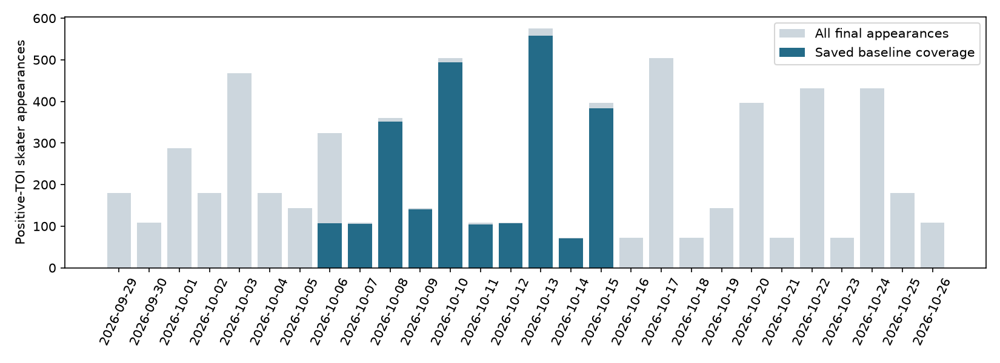

# Season-to-date review through 2026-10-26

187 final regular-season games, 6,731 positive-TOI skater appearances; 2,422 have saved baseline means. 118 games have no saved baseline forecast. Daily challenger comparison covers 48 pregame games. No missing predictions are reconstructed.

## Coverage

[Every game and missing-player count](game_coverage.csv). The baseline selects the most recently created saved pregame season-rate snapshot for each entire game, before examining errors. This is a changing forecast policy, not one fixed model/version or a complete season backtest. It does not fill missing players from older runs. No-appearance forecasts are not scored as zeros. Skaters and goalies remain separate.

## Baseline, all covered appearances

| population | category | rows | games | predicted_total | actual_total | mae | bias | rmse |
| --- | --- | --- | --- | --- | --- | --- | --- | --- |
| all_covered | goals | 2422 | 69 | 432.592 | 417.0 | 0.277 | 0.006 | 0.434 |
| all_covered | assists | 2422 | 69 | 722.701 | 703.0 | 0.404 | 0.008 | 0.545 |
| all_covered | shots | 2422 | 69 | 3907.036 | 3684.0 | 1.043 | 0.092 | 1.337 |
| all_covered | hits | 2422 | 69 | 2809.202 | 2834.0 | 0.877 | -0.01 | 1.172 |
| all_covered | points | 2422 | 69 | 1155.293 | 1120.0 | 0.533 | 0.015 | 0.692 |
| all_covered | pp_points | 2422 | 69 | 253.677 | 256.0 | 0.168 | -0.001 | 0.338 |
| all_covered | penalty_minutes | 2422 | 69 | 1149.664 | 1273.0 | 0.793 | -0.051 | 1.414 |
| all_covered | plus_minus | 2422 | 69 | -0.257 | -23.0 | 0.87 | 0.009 | 1.197 |
| all_covered | toi_minutes | 2422 | 69 | 40479.383 | 40214.8 | 2.23 | 0.109 | 2.942 |

## Issued daily trial comparison

| level | model | rows | games | mae | bias |
| --- | --- | --- | --- | --- | --- |
| player | calibrated_opponent_sog_trial | 1725 | 48 | 1.026 | -0.057 |
| player | candidate | 1725 | 48 | 1.027 | -0.061 |
| player | default | 1725 | 48 | 1.042 | 0.059 |
| player | opponent_form_sog_trial | 1725 | 48 | 1.042 | 0.062 |
| player | usage_shot_context_trial | 1725 | 48 | 1.029 | -0.07 |
| team | calibrated_opponent_sog_trial | 96 | 48 | 4.766 | -1.044 |
| team | candidate | 96 | 48 | 4.798 | -1.107 |
| team | default | 96 | 48 | 4.964 | 1.045 |
| team | opponent_form_sog_trial | 96 | 48 | 4.902 | 1.113 |
| team | usage_shot_context_trial | 96 | 48 | 4.752 | -1.301 |
| saved_fantasy_player | calibrated_opponent_sog_trial | 347 | 48 | 1.309 | -0.212 |
| saved_fantasy_player | candidate | 347 | 48 | 1.312 | -0.227 |
| saved_fantasy_player | default | 347 | 48 | 1.317 | -0.039 |
| saved_fantasy_player | opponent_form_sog_trial | 347 | 48 | 1.316 | -0.023 |
| saved_fantasy_player | usage_shot_context_trial | 347 | 48 | 1.31 | -0.215 |

[All categories, fantasy subgroup, RMSE and bias](model_metrics.csv). Same saved games/positive-TOI appearances per model; team errors use issued lineup scenarios, not postgame participant sums. [Paired game-bootstrap deltas](game_cluster_uncertainty.csv) are exploratory; player rows are not independent games. The full-player comparative dates and frozen sources are recorded in the manifest; missing dates are not reconstructed. The October 9 issued simulation cohort is exported separately; retrospective October 8 calibration reconstructions and October 9 combined-model reconstructions are excluded from prospective comparisons. Independently issued October 9 trials are refreshed against the same official actuals in [opponent SOG metrics](archived_opponent_metrics.csv) and [goalie metrics](archived_goalie_metrics.csv). Keep these older input/format cohorts separate from the daily trial.

## Goalies

| model | category | rows | games | mae | bias |
| --- | --- | --- | --- | --- | --- |
| goalie_history_baseline | shots_against | 94 | 48 | 5.081 | 0.114 |
| goalie_opponent_context_trial | shots_against | 94 | 48 | 5.008 | -0.375 |
| goalie_history_baseline | saves | 94 | 48 | 5.265 | 0.128 |
| goalie_opponent_context_trial | saves | 94 | 48 | 5.112 | -0.312 |
| goalie_history_baseline | goals_against | 94 | 48 | 1.247 | -0.014 |
| goalie_opponent_context_trial | goals_against | 94 | 48 | 1.258 | -0.063 |

Eligible actual starts only; full-start means do not model pulls or empty-net duration. Keep saves and GA conclusions separate.

## Defense chance-creation data

[Past-only team context](defense_context.csv): all-strength and 5v5 D attempts, unblocked attempts, SOG, near-net attempts, assist credits, goals involving a D shooter/assistant, and short same-team followups after a D attempt. Near-net uses a 25-foot attacking-net distance, not a learned xG definition. Followups are within 10 seconds, stop at whistles/period changes/opponent shot attempts or recorded puck actions, and are temporal associations rather than passes or verified possessions. PBP/boxscore disagreements quarantine both teams of the affected games. Counts per game are not per-60 on-ice rates. This source snapshot ends on 2026-10-26; no missing PBP dates are inferred. No D feature coefficient is applied in the main forecasts. See [source strategy](../../../docs/DATA_SOURCE_STRATEGY.md).

## Release fixes

A single command now refreshes inputs, builds all five skater/two goalie models and finalizes reader views. Publication checks require prior-day history, fresh injury/context retrievals, official game/team coverage, finite means, goalie count identities, no outcomes and at least ten minutes before every start. Late builds fail instead of becoming an issued pregame bundle. See NEXT_STEPS.md for the command and limits.
