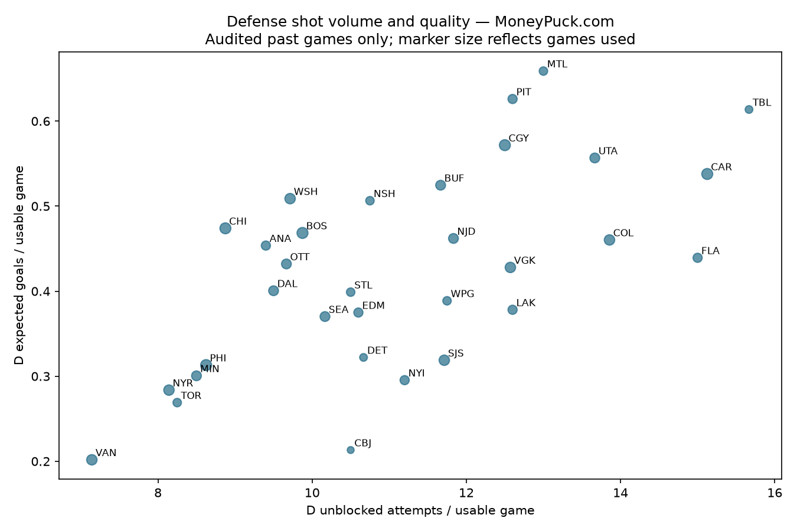

# Source-quality audit

Official NHL PBP: 140 games, 16,025 attempts; 2 team-game SOG discrepancies. Both affected games excluded from derived context.

MoneyPuck.com shot download: 140 games, 11,613 unblocked events, 124 original columns. 49 games quarantined for an official team SOG disagreement. 164 raw positions missing, 0 remain unresolved after the documented same-game NHL fallback.

[Official PBP reconciliation](nhl_pbp_source_audit.csv) · [MoneyPuck reconciliation](moneypuck_shots_source_audit.csv). Retain source differences rather than modifying raw values to match.

## Defense shot quality

[Team values and usable/quarantined sample sizes](defense_shot_quality_context.csv). Both axes use the same usable games within each team. Samples differ across teams and schedules; this is descriptive, not a ranking of talent or evidence of predictive benefit. Credit MoneyPuck.com.

## Kalshi series coverage

| series | markets | two_sided_quotes | median_spread | median_volume |
| --- | --- | --- | --- | --- |
| KXNHLGAME | 94.0 | 94.0 | 0.02 | 62.94 |
| KXNHLTOTAL | 225.0 | 225.0 | 0.24 | 0.0 |
| KXNHLTEAMTOTAL | 130.0 | 111.0 | 0.02 | 0.0 |
| KXNHLSAVES | 0.0 | 0.0 | nan | nan |
| KXNHLAST | 209.0 | 123.0 | 0.04 | 0.0 |
| KXNHLPTS | 261.0 | 168.0 | 0.04 | 0.0 |
| KXNHLANYGOAL | 0.0 | 0.0 | nan | nan |

A public current snapshot, not historical pregame quotes. Empty requested series do not establish absence of equivalent contracts elsewhere. Volume, wide spreads, mapping and quote timing need work before any feature use. No account access, orders or model changes.

[Detailed source priorities and experiment design](../../../docs/DATA_SOURCE_STRATEGY.md).
