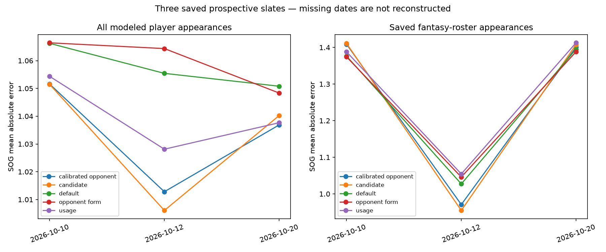

# More than yesterday: saved-model performance through 2026-10-20

The audit covers **151 official finals and 5,435 positive-TOI appearances**. Actual data availability does not imply forecast availability. We do not reconstruct forecasts on missing dates or select versions after seeing errors.

| Evidence tier | Coverage | What we can compare |
| --- | --- | --- |
| Saved season-rate baseline policy | 69 games, 2,422 appearances | All nine skater categories; latest saved pregame whole-game snapshot |
| Complete five-model daily forecasts | 24 games, 864 appearances on October 10, 12 and 20 | Same players per model; team totals, 179 saved fantasy appearances and 48 goalie starts |
| October 17 published export | 12 additional publication-safe games | Team and goalie means only; original full player bundle absent locally |
| Older October 9 issued trial | 4 games, 143 player appearances | Older default/candidate simulation and independent opponent trial, reported separately |
| New defense/shot-quality experiment | October 20 only, 11 games | First prospective test; no earlier frozen feature forecasts exist |

The baseline overlaps the comparative cohorts; do not add those game counts. Complete daily team evidence plus October 17 exports spans 36 distinct games. The new feature test is a subset of October 20, not additional games. Missing dates remain visible in [date coverage](coverage_by_date.csv) and [every game](game_coverage.csv). The October 17 raw bundle is required to expand the full-player sample further.

## Pooled complete daily models — 24 games

| level | model | rows | games | mae | bias |
| --- | --- | --- | --- | --- | --- |
| player | calibrated_opponent_sog_trial | 864 | 24 | 1.042 | -0.026 |
| player | candidate | 864 | 24 | 1.043 | -0.03 |
| player | default | 864 | 24 | 1.058 | 0.09 |
| player | opponent_form_sog_trial | 864 | 24 | 1.058 | 0.095 |
| player | usage_shot_context_trial | 864 | 24 | 1.045 | -0.043 |
| team | calibrated_opponent_sog_trial | 48 | 24 | 4.249 | -0.442 |
| team | candidate | 48 | 24 | 4.227 | -0.524 |
| team | default | 48 | 24 | 4.448 | 1.649 |
| team | opponent_form_sog_trial | 48 | 24 | 4.432 | 1.737 |
| team | usage_shot_context_trial | 48 | 24 | 4.262 | -0.717 |
| saved_fantasy_player | calibrated_opponent_sog_trial | 179 | 24 | 1.361 | -0.355 |
| saved_fantasy_player | candidate | 179 | 24 | 1.364 | -0.367 |
| saved_fantasy_player | default | 179 | 24 | 1.35 | -0.177 |
| saved_fantasy_player | opponent_form_sog_trial | 179 | 24 | 1.348 | -0.164 |
| saved_fantasy_player | usage_shot_context_trial | 179 | 24 | 1.366 | -0.348 |

Across 864 appearances, calibrated opponent SOG MAE is 1.042 versus default 1.058: paired change -0.0167, exploratory 95% interval [-0.0241,-0.0093], with lower total player absolute error in 20/24 games. Candidate is almost tied at 1.043 and improves 19/24 games. This is a small, repeatable improvement within the available all-player sample, not proof of a large fantasy benefit.

The fantasy subset reverses that conclusion: opponent-only 1.348, default 1.350, calibrated opponent 1.361, candidate 1.364. Main team SOG favors candidate (4.227 vs default 4.448) when pooled across all 24 games, unlike yesterday's opponent-only winner. Evaluate the intended population, rather than selecting yesterday's best model.

Goalie saves favor opponent context (4.959 vs 5.221 over 48 starts), while GA is essentially unchanged/slightly worse (1.093 vs 1.085). [Pooled goalie uncertainty](pooled_goalie_uncertainty.csv) keeps those targets separate.

These are three saved dates, not 24 independent daily replications. Players are clustered within games; bootstrap resamples games with appearance weights, and date-wide dependence can make these exploratory intervals optimistic. Model definitions/inputs evolve with issuance history, so the pooled table evaluates the saved forecasting policy, not one fixed fitted parameter vector. No promotion is automatic.

[All categories](model_metrics.csv) · [By date, all categories and interval coverage](model_metrics_by_date.csv) · [Paired all-player/fantasy differences](paired_player_sog_by_date.csv) · [Leave one saved date out](leave_one_date_out_sog.csv) · [Frozen sources](forecast_cohorts.csv).

## Date-by-date SOG

| date | level | model | rows | games | mae | bias |
| --- | --- | --- | --- | --- | --- | --- |
| 2026-10-10 | player | calibrated_opponent_sog_trial | 396 | 11 | 1.052 | -0.001 |
| 2026-10-10 | player | candidate | 396 | 11 | 1.051 | -0.001 |
| 2026-10-10 | player | default | 396 | 11 | 1.066 | 0.119 |
| 2026-10-10 | player | opponent_form_sog_trial | 396 | 11 | 1.066 | 0.119 |
| 2026-10-10 | player | usage_shot_context_trial | 396 | 11 | 1.054 | -0.011 |
| 2026-10-10 | saved_fantasy_player | calibrated_opponent_sog_trial | 78 | 11 | 1.409 | -0.401 |
| 2026-10-10 | saved_fantasy_player | candidate | 78 | 11 | 1.411 | -0.406 |
| 2026-10-10 | saved_fantasy_player | default | 78 | 11 | 1.376 | -0.217 |
| 2026-10-10 | saved_fantasy_player | opponent_form_sog_trial | 78 | 11 | 1.374 | -0.212 |
| 2026-10-10 | saved_fantasy_player | usage_shot_context_trial | 78 | 11 | 1.388 | -0.398 |
| 2026-10-10 | team | calibrated_opponent_sog_trial | 22 | 11 | 3.531 | 0.035 |
| 2026-10-10 | team | candidate | 22 | 11 | 3.455 | 0.037 |
| 2026-10-10 | team | default | 22 | 11 | 3.751 | 2.197 |
| 2026-10-10 | team | opponent_form_sog_trial | 22 | 11 | 3.763 | 2.196 |
| 2026-10-10 | team | usage_shot_context_trial | 22 | 11 | 3.523 | -0.132 |
| 2026-10-12 | player | calibrated_opponent_sog_trial | 72 | 2 | 1.013 | 0.229 |
| 2026-10-12 | player | candidate | 72 | 2 | 1.006 | 0.207 |
| 2026-10-12 | player | default | 72 | 2 | 1.055 | 0.336 |
| 2026-10-12 | player | opponent_form_sog_trial | 72 | 2 | 1.064 | 0.359 |
| 2026-10-12 | player | usage_shot_context_trial | 72 | 2 | 1.028 | 0.2 |
| 2026-10-12 | saved_fantasy_player | calibrated_opponent_sog_trial | 18 | 2 | 0.971 | 0.338 |
| 2026-10-12 | saved_fantasy_player | candidate | 18 | 2 | 0.955 | 0.302 |
| 2026-10-12 | saved_fantasy_player | default | 18 | 2 | 1.027 | 0.5 |
| 2026-10-12 | saved_fantasy_player | opponent_form_sog_trial | 18 | 2 | 1.046 | 0.538 |
| 2026-10-12 | saved_fantasy_player | usage_shot_context_trial | 18 | 2 | 1.054 | 0.378 |
| 2026-10-12 | team | calibrated_opponent_sog_trial | 4 | 2 | 4.061 | 3.887 |
| 2026-10-12 | team | candidate | 4 | 2 | 3.611 | 3.503 |
| 2026-10-12 | team | default | 4 | 2 | 5.804 | 5.804 |
| 2026-10-12 | team | opponent_form_sog_trial | 4 | 2 | 6.219 | 6.219 |
| 2026-10-12 | team | usage_shot_context_trial | 4 | 2 | 4.315 | 3.311 |
| 2026-10-20 | player | calibrated_opponent_sog_trial | 396 | 11 | 1.037 | -0.097 |
| 2026-10-20 | player | candidate | 396 | 11 | 1.04 | -0.103 |
| 2026-10-20 | player | default | 396 | 11 | 1.051 | 0.017 |
| 2026-10-20 | player | opponent_form_sog_trial | 396 | 11 | 1.048 | 0.024 |
| 2026-10-20 | player | usage_shot_context_trial | 396 | 11 | 1.038 | -0.118 |
| 2026-10-20 | saved_fantasy_player | calibrated_opponent_sog_trial | 83 | 11 | 1.401 | -0.461 |
| 2026-10-20 | saved_fantasy_player | candidate | 83 | 11 | 1.408 | -0.475 |
| 2026-10-20 | saved_fantasy_player | default | 83 | 11 | 1.395 | -0.287 |
| 2026-10-20 | saved_fantasy_player | opponent_form_sog_trial | 83 | 11 | 1.388 | -0.272 |
| 2026-10-20 | saved_fantasy_player | usage_shot_context_trial | 83 | 11 | 1.413 | -0.457 |
| 2026-10-20 | team | calibrated_opponent_sog_trial | 22 | 11 | 5.002 | -1.707 |
| 2026-10-20 | team | candidate | 22 | 11 | 5.11 | -1.817 |
| 2026-10-20 | team | default | 22 | 11 | 4.898 | 0.345 |
| 2026-10-20 | team | opponent_form_sog_trial | 22 | 11 | 4.775 | 0.464 |
| 2026-10-20 | team | usage_shot_context_trial | 22 | 11 | 4.991 | -2.034 |

No date is replaced by a postgame reconstruction, and no missing player outcome becomes zero. Same scored appearances per model within date; pooled MAEs weight appearances/observations, not dates equally. Main team errors retain issued lineup assumptions instead of substituting actual participants.

## Extra team-only evidence from October 17

The published view was created after one declared-pregame game had started. We use the more conservative 12-game publication-safe subset. Export hashes verify; full source/issuance provenance cannot be independently recovered from the absent bundle. Exact same-game roster names map goalie IDs; unresolved candidates remain unscored. Keep this tier visible.

Combined **36-game team** summaries (24 complete-bundle games plus 12 export-only games), weighted by team observations:

| model | category | rows | games | mae | bias |
| --- | --- | --- | --- | --- | --- |
| calibrated_opponent_sog_trial | shots | 72 | 36 | 4.215 | -0.494 |
| candidate | shots | 72 | 36 | 4.218 | -0.531 |
| default | shots | 72 | 36 | 4.429 | 1.615 |
| opponent_form_sog_trial | shots | 72 | 36 | 4.411 | 1.655 |
| usage_shot_context_trial | shots | 72 | 36 | 4.224 | -0.91 |

Combined goalie export evidence is separate in [saves/GA metrics](combined_goalie_export_metrics.csv). These broad summaries mix evidence tiers; the 24-game full-bundle table remains the primary comparison. No October 17 player or fantasy projections are invented. [October 17 audit](published_october_17.md).

## Older evidence and the new features

[Baseline metrics across 69 games](baseline_metrics.csv), [baseline errors by date](baseline_by_date.csv), [older October 9 default/candidate simulations](archived_issued_simulation_metrics.csv), [independent opponent trial](archived_opponent_metrics.csv), and [older goalie trial](archived_goalie_metrics.csv) are retained as separate cohorts. Their populations and input conventions differ; do not treat them as a five-model comparison.

The new D/shot-quality variants have **only 11 prospective games**, because they were first frozen on October 20. The [51-game corrected-data retrospective screen](../feature_evidence_2026-10-20/README.md) is additional research evidence, not 51 more prospective forecasts. [October 20 prospective results](../results_2026-10-20/README.md) show D measures beating their research control but trailing the best existing team model; uncertainty includes no gain.

Next: choose the target/category and fantasy population before promotion, continue frozen future comparisons, and improve lineup/starter confirmation. More historical actuals cannot recover forecasts that were never saved. No coefficients are refitted in this review.
