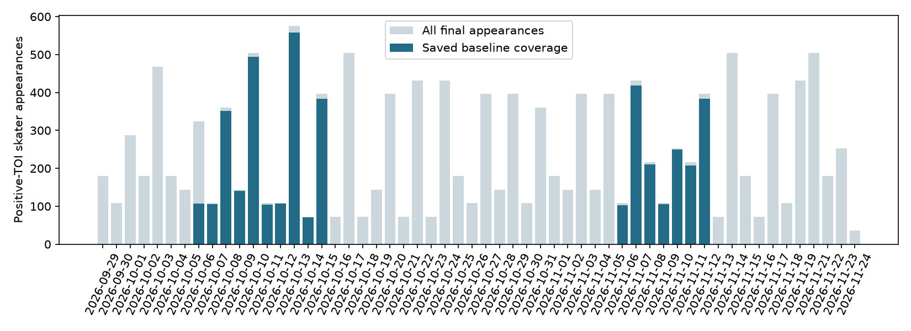

# Season-to-date review through 2026-11-24

385 final regular-season games, 13,859 positive-TOI skater appearances; 4,099 have saved baseline means. 268 games have no saved baseline forecast. Daily challenger comparison covers 142 pregame games. No missing predictions are reconstructed.

## Coverage

[Every game and missing-player count](game_coverage.csv). The baseline selects the most recently created saved pregame season-rate snapshot for each entire game, before examining errors. This is a changing forecast policy, not one fixed model/version or a complete season backtest. It does not fill missing players from older runs. No-appearance forecasts are not scored as zeros. Skaters and goalies remain separate.

## Baseline, all covered appearances

| population | category | rows | games | predicted_total | actual_total | mae | bias | rmse |
| --- | --- | --- | --- | --- | --- | --- | --- | --- |
| all_covered | goals | 4099 | 117 | 733.872 | 704.0 | 0.276 | 0.007 | 0.428 |
| all_covered | assists | 4099 | 117 | 1222.749 | 1197.0 | 0.404 | 0.006 | 0.548 |
| all_covered | shots | 4099 | 117 | 6626.674 | 6306.0 | 1.04 | 0.078 | 1.334 |
| all_covered | hits | 4099 | 117 | 4831.398 | 4800.0 | 0.869 | 0.008 | 1.154 |
| all_covered | points | 4099 | 117 | 1956.622 | 1901.0 | 0.531 | 0.014 | 0.688 |
| all_covered | pp_points | 4099 | 117 | 431.441 | 460.0 | 0.172 | -0.007 | 0.343 |
| all_covered | penalty_minutes | 4099 | 117 | 1978.037 | 2201.0 | 0.808 | -0.054 | 1.505 |
| all_covered | plus_minus | 4099 | 117 | 0.663 | -42.0 | 0.867 | 0.01 | 1.202 |
| all_covered | toi_minutes | 4099 | 117 | 68447.419 | 68029.817 | 2.226 | 0.102 | 2.951 |

## Issued daily trial comparison

| level | model | rows | games | mae | bias |
| --- | --- | --- | --- | --- | --- |
| player | calibrated_opponent_sog_trial | 5094 | 142 | 1.021 | -0.049 |
| player | candidate | 5094 | 142 | 1.021 | -0.051 |
| player | default | 5094 | 142 | 1.038 | 0.068 |
| player | opponent_form_sog_trial | 5094 | 142 | 1.039 | 0.07 |
| player | pp_opportunity_trial | 2078 | 58 | 1.026 | -0.05 |
| player | usage_shot_context_trial | 5094 | 142 | 1.026 | -0.065 |
| player | usage_toi_only_trial | 2078 | 58 | 1.026 | -0.05 |
| team | calibrated_opponent_sog_trial | 284 | 142 | 4.711 | -0.838 |
| team | candidate | 284 | 142 | 4.703 | -0.874 |
| team | default | 284 | 142 | 4.911 | 1.262 |
| team | opponent_form_sog_trial | 284 | 142 | 4.899 | 1.3 |
| team | pp_opportunity_trial | 116 | 58 | 4.742 | -0.784 |
| team | usage_shot_context_trial | 284 | 142 | 4.707 | -1.132 |
| team | usage_toi_only_trial | 116 | 58 | 4.742 | -0.784 |
| saved_fantasy_player | calibrated_opponent_sog_trial | 805 | 113 | 1.298 | -0.137 |
| saved_fantasy_player | candidate | 805 | 113 | 1.299 | -0.151 |
| saved_fantasy_player | default | 805 | 113 | 1.314 | 0.035 |
| saved_fantasy_player | opponent_form_sog_trial | 805 | 113 | 1.315 | 0.05 |
| saved_fantasy_player | pp_opportunity_trial | 205 | 29 | 1.354 | -0.068 |
| saved_fantasy_player | usage_shot_context_trial | 805 | 113 | 1.309 | -0.146 |
| saved_fantasy_player | usage_toi_only_trial | 205 | 29 | 1.354 | -0.068 |

[All categories, fantasy subgroup, RMSE and bias](model_metrics.csv). Same saved games/positive-TOI appearances per model; team errors use issued lineup scenarios, not postgame participant sums. [Paired game-bootstrap deltas](game_cluster_uncertainty.csv) compare the SOG variants issued throughout the full cohort, using positive-TOI appearances with scored errors; newer challengers with fewer issue dates remain in the descriptive metrics only. Uncertainty is exploratory; player rows are not independent games. The full-player comparative dates and frozen sources are recorded in the manifest; missing dates are not reconstructed. The October 9 issued simulation cohort is exported separately; retrospective October 8 calibration reconstructions and October 9 combined-model reconstructions are excluded from prospective comparisons. Independently issued October 9 trials are refreshed against the same official actuals in [opponent SOG metrics](archived_opponent_metrics.csv) and [goalie metrics](archived_goalie_metrics.csv). Keep these older input/format cohorts separate from the daily trial.

## Goalies

| model | category | rows | games | mae | bias |
| --- | --- | --- | --- | --- | --- |
| goalie_history_baseline | shots_against | 281 | 142 | 5.031 | 0.841 |
| goalie_opponent_context_trial | shots_against | 281 | 142 | 4.946 | 0.478 |
| goalie_history_baseline | saves | 281 | 142 | 5.202 | 0.891 |
| goalie_opponent_context_trial | saves | 281 | 142 | 5.07 | 0.564 |
| goalie_history_baseline | goals_against | 281 | 142 | 1.159 | -0.05 |
| goalie_opponent_context_trial | goals_against | 281 | 142 | 1.159 | -0.086 |

Eligible actual starts only; full-start means do not model pulls or empty-net duration. Keep saves and GA conclusions separate.

## Defense chance-creation data

[Past-only team context](defense_context.csv): all-strength and 5v5 D attempts, unblocked attempts, SOG, near-net attempts, assist credits, goals involving a D shooter/assistant, and short same-team followups after a D attempt. Near-net uses a 25-foot attacking-net distance, not a learned xG definition. Followups are within 10 seconds, stop at whistles/period changes/opponent shot attempts or recorded puck actions, and are temporal associations rather than passes or verified possessions. PBP/boxscore disagreements quarantine both teams of the affected games. Counts per game are not per-60 on-ice rates. This source snapshot ends on 2026-11-24; no missing PBP dates are inferred. No D feature coefficient is applied in the main forecasts. See [source strategy](../../../docs/DATA_SOURCE_STRATEGY.md).

## Release fixes

A single command now refreshes inputs, builds all five skater/two goalie models and finalizes reader views. Publication checks require prior-day history, fresh injury/context retrievals, official game/team coverage, finite means, goalie count identities, no outcomes and at least ten minutes before every start. Late builds fail instead of becoming an issued pregame bundle. See NEXT_STEPS.md for the command and limits.
