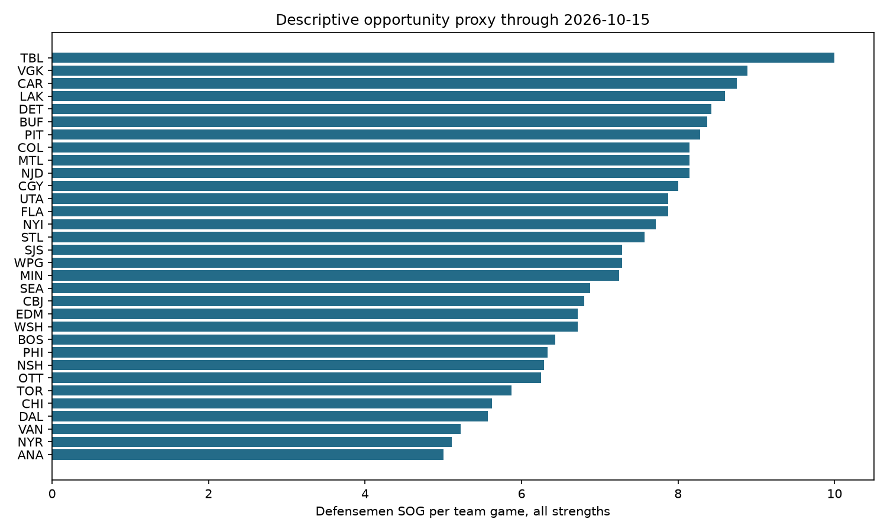
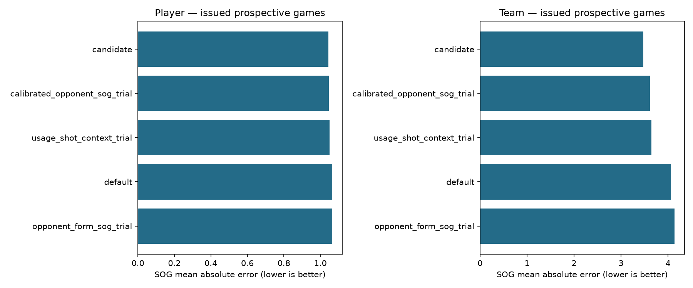

# Forecast review: 2026-10-12 through 2026-10-15

Completed games in the requested date range; later dates are excluded. No missing forecasts were reconstructed. Prospective trial dates this week: 2026-10-12. Older default forecasts were issued 2026-10-09T19:50:54.720471+00:00. Missing predictions are coverage failures, not zero predictions.

## Coverage

| game_date | final_games | appearances | baseline_covered | baseline_missing | daily_trial_games |
| --- | --- | --- | --- | --- | --- |
| 2026-10-12 | 3 | 108 | 107 | 1 | 2 |
| 2026-10-13 | 16 | 575 | 558 | 17 | 0 |
| 2026-10-14 | 2 | 72 | 71 | 1 | 0 |
| 2026-10-15 | 11 | 396 | 383 | 13 | 0 |

## This week: every evaluated model

| level | model | rows | games | mae | bias |
| --- | --- | --- | --- | --- | --- |
| player | calibrated_opponent_sog_trial | 72 | 2 | 1.013 | 0.229 |
| player | candidate | 72 | 2 | 1.006 | 0.207 |
| player | default | 72 | 2 | 1.055 | 0.336 |
| player | opponent_form_sog_trial | 72 | 2 | 1.064 | 0.359 |
| player | usage_shot_context_trial | 72 | 2 | 1.028 | 0.2 |
| team | calibrated_opponent_sog_trial | 4 | 2 | 4.061 | 3.887 |
| team | candidate | 4 | 2 | 3.611 | 3.503 |
| team | default | 4 | 2 | 5.804 | 5.804 |
| team | opponent_form_sog_trial | 4 | 2 | 6.219 | 6.219 |
| team | usage_shot_context_trial | 4 | 2 | 4.315 | 3.311 |

The two-game trial is too small to promote a model. All nine skater/team categories, RMSE, totals and bias are in [model metrics](model_metrics.csv). Team metrics use issued lineup scenarios; player metrics condition on positive-TOI appearances.

### Older default, by date

| game_date | rows | games | mae | bias | predicted_total | actual_total |
| --- | --- | --- | --- | --- | --- | --- |
| 2026-10-12 | 107 | 3 | 1.053 | 0.251 | 182.904 | 156.0 |
| 2026-10-13 | 558 | 16 | 1.015 | 0.06 | 896.507 | 863.0 |
| 2026-10-14 | 71 | 2 | 1.057 | 0.232 | 118.459 | 102.0 |
| 2026-10-15 | 383 | 11 | 1.071 | -0.001 | 610.431 | 611.0 |

These matched-player sums select participants after the game; they are not pregame team forecasts. Ownership and injury labels retain their original snapshot dates. Refreshed official actuals can differ from archived readouts because of source corrections; forecasts are unchanged.

### Goalies this week

| model | category | rows | games | mae | bias |
| --- | --- | --- | --- | --- | --- |
| goalie_history_baseline | saves | 4 | 2 | 5.076 | 1.789 |
| goalie_opponent_context_trial | saves | 4 | 2 | 4.041 | 2.184 |
| goalie_history_baseline | shots_against | 4 | 2 | 4.855 | 2.264 |
| goalie_opponent_context_trial | shots_against | 4 | 2 | 3.697 | 2.706 |
| goalie_history_baseline | goals_against | 4 | 2 | 0.654 | 0.475 |
| goalie_opponent_context_trial | goals_against | 4 | 2 | 0.785 | 0.522 |

Full-start forecasts are compared only with eligible actual starters. Relief, pulls, empty-net time and uncertain starters limit interpretation.

## Broader prospective evidence

| level | model | rows | games | mae | bias |
| --- | --- | --- | --- | --- | --- |
| player | calibrated_opponent_sog_trial | 468 | 13 | 1.046 | 0.034 |
| player | candidate | 468 | 13 | 1.044 | 0.031 |
| player | default | 468 | 13 | 1.065 | 0.152 |
| player | opponent_form_sog_trial | 468 | 13 | 1.066 | 0.156 |
| player | usage_shot_context_trial | 468 | 13 | 1.05 | 0.021 |
| team | calibrated_opponent_sog_trial | 26 | 13 | 3.612 | 0.628 |
| team | candidate | 26 | 13 | 3.479 | 0.57 |
| team | default | 26 | 13 | 4.067 | 2.752 |
| team | opponent_form_sog_trial | 26 | 13 | 4.141 | 2.815 |
| team | usage_shot_context_trial | 26 | 13 | 3.645 | 0.397 |

Keep default as baseline and candidate as challenger. The prior October 13 readout contains the paired game-bootstrap and fantasy subgroup reversal; the new days do not add prospective challenger evidence. Do not tune on these outcomes and report the result as unseen performance.

## Which inputs move forecasts?

| component | mean_absolute_shot_movement |
| --- | --- |
| calibration_contribution | 0.12 |
| shot_rate_contribution | 0.111 |
| matchup_contribution | 0.068 |
| toi_contribution | 0.036 |

[Per-player accounting](player_contributions.csv) and [team accounting](team_contributions.csv) show signed SOG changes for every scored player in the October 10/12 trials. Order: baseline → TOI → shot rate → calibration → matchup. Contributions sum exactly to the usage model minus baseline, with a separate feasibility residual. The decomposition depends on order and measures movement, not causal importance or validated predictive value. The absolute_error_delta columns show realized sequential changes: negative improves player error, positive worsens it. Team rows sum these player error changes, not team-total absolute errors. Team sums here condition on actual participants and are diagnostics.

PP/EV usage, rest, home/away and ESPN benchmarks were saved as context but have no fitted coefficients. The default uses historical/current production; the candidate adds fixed shot/assist calibration. Opponent and combined variants add team context; usage replaces the SOG rate/exposure and blends raw SOG/xOnGoal context. Current model comparisons confound inputs: isolate TOI-only, rate-only, matchup-only and D-context-only variants on future games.

## Defense-created opportunity

[All 32 team inputs](defense_opportunity.csv): D shots/game, D share of team shots, D assist credits/game, and D shots per 60 summed defense-player minutes, with sample sizes and latest dates. This uses all final regular-season games before the stated cutoff, not just this week. It measures defensemen’s direct production, not offensive sequences created, distinct assisted chances, pair effects or on-ice xG. No TOI threshold beyond positive participation is imposed. No forecast coefficient has been fitted. Future daily builds now export the same context using strictly pre-target-date history.

## Accuracy visual

## Next steps

1. Issue complete daily bundles before each game: fresh injuries, current source cutoffs, official game IDs, hashes and lineup coverage; finish the date-aware finalizer and standalone MoneyPuck refresh.
2. Acquire NHL play-by-play and distinguish D shots/attempts, D assists, 5v5/PP exposure, and D-involved sequences leading to chances. Use lagged, exposure-adjusted, shrunken team inputs; validate against existing shot/usage features.
3. Freeze one-input-at-a-time challengers before future games. Compare paired game errors, fantasy/position/role groups, calibration and uncertainty; evaluate goalie saves and GA separately.
4. Automate postgame acquisition → hash/coverage validation → review → charts. Add scheduled CI after a credential-free pregame runner has freshness gates, retries, idempotence and failure alerts. Keep personal ESPN access local.

## Reproducibility

Official NHL boxscore/scoring-summary sources, hashes and local input paths are recorded in [manifest](manifest.json). Corrected actuals retrieved later do not change frozen forecasts. Full snapshots remain local; compact report tables and figures are published.
